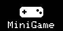

# 🎮 MiniGame: ESP32-S3 Multitool Console



A handheld game console built on the **ESP32-S3 (N16R8)** with a 128×64 SSD1306 OLED: 16 games, DOOM, a gallery, video recording, screenshots, OTA updates and a web control panel.

## ✨ Features

- **2D games:** Flappy Bird, Snake, Pong, Dino Run, Tetris, Space Invaders, Breakout, Pac-Man
- **3D games:** Monster Hunt, Bot Duel, FPS Test, **DOOM**
- **Custom:** your own game in `custom.cpp`
- **Bin: Upload / Play:** load `.bin` games over Wi-Fi
- **Gallery:** PNG screenshots and videos stored in flash
- **Video recording** (3–60 s) and **screenshots** via button combos
- **OTA:** update the firmware from a browser
- **EspBench:** CPU / RAM / PSRAM / Flash benchmark
- **Battery:** gauge, low-battery warnings, auto shutdown (optional)
- **Settings:** difficulty, combos, recording length, FPS cap, storage format

## 🧰 Hardware

| Part | Notes |
|---|---|
| ESP32-S3 **N16R8** | 16 MB Flash, 8 MB PSRAM |
| SSD1306 OLED 128×64 (I2C) | address `0x3C` |
| 7 buttons | wired to GND, `INPUT_PULLUP` |
| TP4056 + Li-ion + MT3608 | optional, for battery power |

### Pinout

| Device | GPIO |
|---|---|
| OLED SDA | 20 |
| OLED SCL | 21 |
| UP | 18 |
| DOWN | 10 |
| LEFT | 15 |
| RIGHT | 12 |
| SELECT | 2 *(do not hold during power-up)* |
| BOOT | 0 *(on-board button)* |
| BACK | 40 |
| Battery (ADC) | 4 *(through a 1:2 divider)* |

All pins are defined in `pins.h`.

## 📦 Install from ZIP

1. Click **Code → Download ZIP** on the repository page.
2. Extract the archive. You get a folder such as `minigame-main`.
3. **Rename the folder to `minigame`.** Arduino IDE requires the folder name to match the main file `minigame.ino`.
4. Make sure it contains:

```
minigame/
├── minigame.ino
├── pins.h
├── pins.cpp
├── custom.cpp
├── partitions.csv
├── minigame.jpg
└── README.md
```

5. Open `minigame.ino` in Arduino IDE. The other files load as tabs automatically.

## 🔧 Arduino IDE Setup

1. Install the board package: **Boards Manager → esp32 (Espressif Systems)**.
2. Install libraries via **Library Manager**:
   - `Adafruit SSD1306`
   - `Adafruit GFX Library`
3. Select **ESP32S3 Dev Module** and set **Tools**:

| Option | Value |
|---|---|
| Flash Size | 16MB (128Mb) |
| PSRAM | OPI PSRAM |
| Partition Scheme | Custom *(uses `partitions.csv`)* |
| USB CDC On Boot | Disabled |

4. For the first upload enable **Tools → Erase All Flash Before Sketch Upload**.
5. Click **Upload**.

## 🎮 Controls

| Action | Buttons |
|---|---|
| Navigate | UP / DOWN |
| Select | SELECT |
| Back to menu | BOOT or BACK |
| Screenshot | SELECT + BACK *(configurable in Settings)* |
| Record video | LEFT + RIGHT *(configurable in Settings)* |

**DOOM:** UP/DOWN move, LEFT/RIGHT turn, SELECT fire.

## 🎬 Viewing Photos and Videos

1. Menu → **Bin: Upload**.
2. Connect to Wi-Fi `MiniGame-Upload` (password `12345678`).
3. Open `http://192.168.4.1` in a browser.
4. Photos open full-size on click. For videos press **watch / MP4**, then **Convert & download**.
5. For TikTok or social media, re-encode with ffmpeg:

```
ffmpeg -i minigame.webm -f lavfi -i anullsrc=r=44100:cl=stereo -shortest -vf "scale=1080:-2:flags=neighbor,pad=1080:1920:(ow-iw)/2:(oh-ih)/2:black,fps=30,format=yuv420p" -c:v libx264 -crf 18 -c:a aac -movflags +faststart tiktok.mp4
```

## 🔋 Battery (optional)

```
Li-ion → TP4056 → switch → MT3608 (5.0 V) → Schottky diode → 5V pin
Battery+ → R → GPIO4 → R → GND   (two equal resistors, e.g. 100k + 100k)
```

- Enable it in **Settings → Battery: ON** (off by default).
- Calibrate with `BAT_CAL` in the sketch: `BAT_CAL = real_V / shown_V`.
- At 20% a warning appears; at 10% the device shows *Charge battery* and goes to deep sleep.
- If the device keeps sleeping, power it on while holding **BACK** to disable the monitor.

## 🕹️ Writing Your Own Game

Edit `custom.cpp`. Keep the four names `CUSTOM_GAME_NAME`, `customReset`, `customUpdate`, `customDraw`, since the main sketch links to them. Use `isHeld()` for held buttons, `btnPressed[]` for single presses and `diffLerp(easy, normal, hard)` for difficulty. Screenshots and recording work in your game automatically.

## ⚠️ Troubleshooting

| Problem | Fix |
|---|---|
| `Combo / Ent does not name a type` | keep these structs in `pins.h`, not in the `.ino` |
| No PSRAM | set `Tools → PSRAM → OPI PSRAM` |
| Photos/videos not saved | set `Partition Scheme → Custom` and keep `partitions.csv` |
| Screen stays dark | check SDA/SCL wiring and address `0x3C` |
| Device keeps going to sleep | battery monitor on without a divider: hold **BACK** at power-up |

##🛠️Recommendation boards

| esp32s3-have 8mb psram
| esp32-s2-wrower - it have 2mb psram
 You can use anybody board but you need psram or set off video


|
